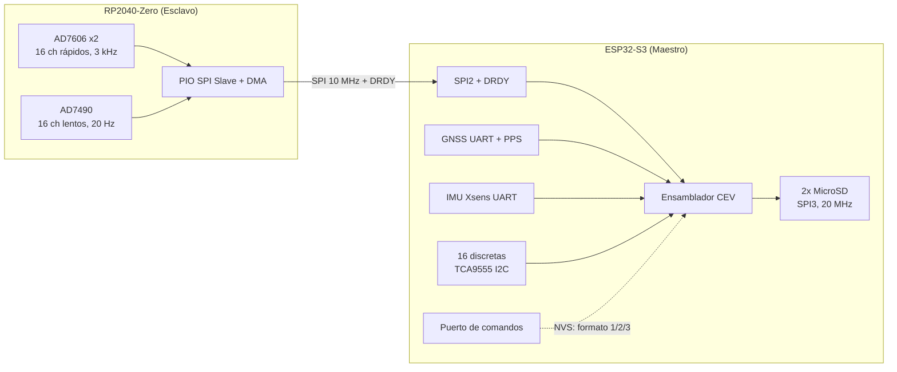

# Arquitectura del sistema FDR (firmware vigente)

Registrador de datos de vuelo para ensayos del CEV-FAA, desarrollado en el IUA. Dos microcontroladores bajo FreeRTOS se reparten la adquisición y el almacenamiento.

La referencia más nueva del firmware es el árbol **`FDR_TB`** (protoboard). El árbol **`FDR`** es el que iría a la PCB y todavía no incorpora algunos cambios de `FDR_TB`. Esas diferencias están al final de este documento.

Los archivos `01_Especificación de Requisitos_V1.0.md`, `03_Arquitectura General.md` y `05_(RS) — FDR Firmware v0.9.md` son la línea base original. Varios ítems de esa línea (eMMC, RTC DS3232, USB-CDC, AD4131, enlace LVDS, `SYNC_TRIG`) no forman parte del firmware actual.

---

## Visión general



| Aspecto | Maestro (ESP32-S3) | Esclavo (RP2040-Zero) |
|---------|-------------------|------------------------|
| Rol | Ensamblado CEV, GNSS, IMU, discretas, almacenamiento, comandos | Adquisición analógica |
| Framework | ESP-IDF v5.5, FreeRTOS | Pico SDK 2.2, FreeRTOS SMP |
| Tareas de vuelo | 9 | 6 |
| Bus inter-placa | SPI2 master, 10 MHz | Esclavo SPI por PIO (no usa el PL022) |
| Sensores locales | GNSS, IMU Xsens, TCA9555 | 2× AD7606, 1× AD7490 |

El esclavo no graba nada. Muestrea, pone timestamp y transmite. El maestro junta eso con GNSS, IMU y discretas, arma tramas CEV y las escribe en las dos MicroSD.

---

## Placa esclava (RP2040-Zero)

El mapa de pines es el mismo en `FDR` y en `FDR_TB` (`include/pin_config.h`, consensuado en mayo 2026).

### SPI0 — adquisición (el RP2040 es master)

| Pin | Función |
|-----|---------|
| GP4 | MISO |
| GP6 | SCK |
| GP7 | MOSI |
| GP5 | CS del AD7606 #1 (8 canales) |
| GP27 | CS del AD7606 #2 (8 canales) |
| GP9 | CS del AD7490 (16 canales lentos) |
| GP10 | CONVST, compartido por los dos AD7606 |
| GP12 | BUSY del AD7606 #1 |
| GP28 | BUSY del AD7606 #2 |
| GP15 | RESET, compartido |

Los dos drivers comparten SPI0 con un mutex. El AD7606 usa modo SPI 2 (CPOL=1, CPHA=0). El AD7490 usa modo SPI 3 (CPOL=1, CPHA=1): al tomar el mutex el driver lento cambia el modo del bus y al soltarlo lo devuelve al modo 2. La conversión del AD7490 arranca con el flanco de bajada de CS; no tiene línea DRDY. GP29 quedó libre al reemplazar el AD4131 por el AD7490.

- **Rápidos:** 16 canales SAR de 16 bits, muestreo simultáneo. Un timer de hardware de 333 µs (~3003 Hz) notifica a `tsk_acq_fast_slave`.
- **Lentos:** 16 canales SAR de 12 bits, un barrido cada 50 ms (~20 Hz). El valor se guarda en `int16_t`.

### Enlace hacia el maestro (PIO, el RP2040 es slave)

El periférico SPI de hardware del RP2040 (PL022) desplaza bits en modo esclavo. El enlace se implementó con una máquina PIO de 3 instrucciones (SPI modo 0) alimentada por DMA de 32 bits.

| Pin | Función |
|-----|---------|
| GP0 | CS (entrada) |
| GP1 | MISO / TX hacia el maestro |
| GP2 | SCK (entrada) |
| GP3 | DRDY (salida). Avisa que hay un paquete listo |

No hay MOSI de aplicación: el esclavo solo transmite.

### Sincronización y control

| Pin | Función |
|-----|---------|
| GP26 | PPS del GNSS. La ISR corrige el offset de `time_us_64()` |
| GP13 | Reservado (stand-by / modo descarga) |
| GP16 | LED NeoPixel de la placa |
| GP11, GP29 | Libres |

No hay cable `SYNC_TRIG`. El coordinador queda bloqueado hasta el primer flanco de bajada de CS del enlace SPI; con eso despierta al resto de las tareas y se elimina.

El timestamp de cada muestra es `(time_us_64() + offset_pps) * 1000` nanosegundos. El offset se ajusta en cada PPS para absorber el drift del oscilador.

### Tareas del esclavo

| Prio | Tarea | Stack | Qué hace |
|:----:|-------|------:|----------|
| 8 | `tsk_coordinator_slave` | 768 B | Espera el primer CS bajo, despierta al resto y se destruye |
| 7 | `tsk_acq_fast_slave` | 1 KB | 16 canales a ~3 kHz, cola `q_fast_data` (profundidad 64) |
| 6 | `tsk_acq_slow_slave` | 1 KB | 16 canales a 20 Hz, cola `q_slow_data` (profundidad 2) |
| 6 | `tsk_spi_link_slave` | 1 KB | Prioriza la cola rápida, arma header + CRC32, sube DRDY |
| 6 | `tsk_time_sync_slave` | 768 B | Aplica la corrección de PPS capturada por la ISR |
| 1 | `tsk_watchdog_slave` | 256 B | `watchdog_update()` cada 500 ms. Timeout de hardware: 2000 ms |

En `FDR_TB` las tareas de adquisición no hablan con los ADC: generan rampas (los rápidos arrancan en 0, los lentos en 5000) para probar el enlace y el formato CEV sin los conversores en la protoboard. Los drivers `fast_signals` y `slow_signals` están en el árbol, iguales a los de `FDR`, y el `main` no los inicializa.

---

## Placa maestra (ESP32-S3)

### Pines

El enlace SPI y las dos SD coinciden en los dos árboles. GNSS, puerto de comandos y el segundo MISO no.

| Función | PCB (`FDR`) | Protoboard (`FDR_TB`) |
|---------|-------------|------------------------|
| SPI2 MISO / CLK / CS | GPIO 13 / 12 / 10 | Igual |
| DRDY | GPIO 11 | Igual |
| TCA9555 I2C | SCL GPIO 4, SDA GPIO 5, 400 kHz, dirección `0x20` | Mismos pines declarados. No se lee el chip: no está en el banco |
| MicroSD SPI3 | MOSI 38, CLK 39, MISO 40, CS1 GPIO 1, CS2 GPIO 2, 20 MHz | Igual, más **MISO2 en GPIO 21** |
| GNSS UART2 | RX 17, TX 16, PPS 15 | RX 35, TX 36, PPS 37 |
| IMU Xsens UART0 | RX 44, TX 43, 115200 | Mismos pines, datos simulados |
| Comandos | UART1, RX 41, TX 42, RS-232 vía MAX3232, 115200 | UART0 del DevKit (GPIO 43/44, puerto USB-UART). Los logs van por USB-Serial-JTAG |
| Power-loss | GPIO 46, flanco de bajada, pull-up | Igual |
| LED | GPIO 0 | Igual |
| USB OTG | GPIO 19 / 20 (D- / D+) | Igual |

En la PCB el GNSS no puede usar GPIO 35/36/37: el módulo trae PSRAM octal y esos pines quedan tomados por la memoria aunque `CONFIG_SPIRAM` esté apagado. En el DevKit de la protoboard esos pines están libres, y el PPS simulado sale por GPIO 37 hacia GP26 del RP2040.

### Discretas

El diseño es un expansor **TCA9555** en el maestro (16 entradas, bitmap de 16 bits, debounce por software de 3 muestras consecutivas, lectura a 20 Hz en `tsk_discrete_master`). El paquete `PKT_TYPE_DISCRETE` (`0x03`) está declarado en `protocol.h` y no se usa: las discretas no cruzan el enlace SPI.

En `FDR_TB`, `tsk_sim_discrete` escribe un patrón simulado en el ensamblador CEV. Es un sustituto de banco, no un cambio de arquitectura.

### Almacenamiento

Dos MicroSD en SPI3 a 20 MHz, montadas en `/sd1` y `/sd2`. La grabación sigue si al menos una responde. Un mutex serializa el acceso. Los CS se fuerzan a alto antes de inicializar el bus: los módulos genéricos traen pull-down en CS y, si los dos quedan activos, colisionan en MISO (error `0x108`).

Cada archivo `FDR_XXXX.bin` empieza con esta cabecera de 12 bytes y después las tramas CEV en `int16_t` consecutivos, sin separadores:

| Offset | Campo | Tipo | Valor |
|--------|-------|------|-------|
| 0–3 | magic | uint32 | `0xFD464452` |
| 4 | version | uint8 | `1` |
| 5 | format | uint8 | `1`, `2` o `3` |
| 6–7 | reserved | uint16 | `0` |
| 8–11 | crc32 | uint32 | CRC32 de los bytes [0..7] |

Si se llena el espacio, se escribe `FDR_FULL.ERR` en las tarjetas que sigan vivas. El formato activo se lee de NVS al arrancar.

### Componentes

| Componente | Rol |
|------------|-----|
| `master_logic` | Arranque, tareas, ISR de power-loss |
| `master_config` | `pin_config.h` |
| `spi_link` + `spi_manager` | SPI2 a 10 MHz, handshake por flanco de DRDY, CRC32, colas `q_rx_fast` y `q_rx_slow` |
| `sample_format` | Buffer de parámetros y tablas de subconmutación F1/F2/F3 |
| `sd_storage` | FAT, archivos de vuelo, espacio libre, formateo |
| `gnss` | NMEA (`$GPRMC`, `$GPGGA`) y PPS |
| `imu_xsens` | Protocolo binario MT. 12 magnitudes: accel, gyro, mag, roll, pitch, yaw |
| `discrete_signals` | TCA9555. En el banco, la tarea equivalente es simulada |
| `cmd_port` | Mensajes de 6 bytes. No se registra en el supervisor (en vuelo puede no recibir nada) |
| `supervisor` | Check-in por tarea. Si alguna vence el timeout, loguea. No reinicia el ESP32 |
| `usb_transfer` | USB Host MSC, solo en modo descarga |

### Puerto de comandos

Mensaje de 6 bytes, little-endian: header `0xAA55`, comando `uint16`, dato `uint16`. La respuesta tiene la misma forma.

| Comando | Código | Efecto |
|---------|--------|--------|
| Leer parámetro | `0x0001` | Canal 0–15 rápido, 16–31 lento, 32–47 discreta |
| Escribir formato | `0x0002` | Guarda 1, 2 o 3 en NVS |
| Leer formato | `0x0003` | Devuelve el formato de NVS |
| Formatear SD | `0x0004` | Exige la clave `0x55AA` |

`ACK` ok = `0x0001`. Error = `0xFFFF`.

### Tareas del maestro

`tsk_spi_link_master` la crea `spi_link_start()`, anclada al core 1.

| Prio | Tarea | Stack | Qué hace |
|:----:|-------|------:|----------|
| 12 | `tsk_spi_link_master` | 4 KB | Duerme en la ISR de DRDY (GPIO 11). Timeout 50 ms. Core 1 |
| 8 | `tsk_frame_writer_master` | 8 KB | Arma tramas a periodo fijo y las escribe. Atiende power-loss |
| 7 | `tsk_time_sync_master` | 4 KB | GNSS → fecha, hora y posición del ensamblador |
| 5 | `tsk_data_proc_master` | 4 KB | Cola rápida → ANA 1–16 |
| 5 | `tsk_slow_proc_master` | 4 KB | Cola lenta → ANA 17–32 |
| 5 | `tsk_discrete_master` | 2 KB | 20 Hz. En TB: `tsk_sim_discrete` |
| 5 | `tsk_imu_master` | 4 KB | 100 Hz. En TB: IMU simulada, refresco desde el writer |
| 4 | `tsk_cmd_port_master` | 4 KB | Poll cada 5 ms. Fuera del supervisor |
| 3 | `tsk_supervisor_master` | 2 KB | Espera 10 s y después revisa cada 5 s |

El writer no es una segunda tarea aparte del ensamblador: `tsk_frame_writer_master` llama a `sample_format_assemble_frame()`. Periodo de tick: 1 ms y 3 tramas por tick en F1/F2 (3000 tramas/s); 10 ms y 1 trama en F3 (100 tramas/s).

### Escalas IMU → int16

| DSP | Magnitud | Escala | Resolución |
|-----|----------|--------|------------|
| 1–3 | Aceleración X/Y/Z | ×500 | 0,002 m/s² |
| 4–6 | Giróscopo X/Y/Z | ×100 | 0,01 °/s |
| 7–9 | Magnetómetro X/Y/Z | ×10000 | 0,0001 a.u. |
| 10 | Roll | ×100 | 0,01° |
| 11 | Pitch | ×100 | 0,01° |
| 12 | Sincronismo PPS | — | — |
| 13 | Yaw | ×100 | 0,01° |

DSP 13 ocupa una celda que en la planilla CEV figuraba libre: word 17 del frame 39 (F1), word 11 del frame 13 (F2), word 6 del frame 7 (F3).

### Formatos CEV

| Formato | Frames/ciclo | Words/frame | Ciclos/s | Frames/s | Orden de magnitud |
|:-------:|:------------:|:-----------:|:--------:|:--------:|:-----------------:|
| F1 | 40 | 17 | 75 | 3000 | ~102 KB/s |
| F2 | 40 | 11 | 75 | 3000 | ~66 KB/s |
| F3 | 10 | 6 | 10 | 100 | ~1,2 KB/s |

En F1 las words 0–15 son ANA 1–16 en todas las tramas y la word 16 rota (discretas, ANA 17–32, DSP, tiempo y posición GNSS). F2 deja ANA 1–9 fijos y subconmuta dos words. F3 subconmuta las seis.

En `FDR_TB` el buffer `s_params` se lee y se escribe dentro de una sección crítica (`portMUX`). En `FDR` esas actualizaciones todavía no toman ese mutex.

---

## Protocolo SPI inter-placa

```
┌───────┬──────┬──────────┬────────────┬────────┬─────────────┬───────┐
│ Magic │ Type │ Sequence │ Timestamp  │ Length │   Payload   │ CRC32 │
│ 0xFD  │  1B  │   2B     │    8B      │   2B   │  variable   │  4B   │
└───────┴──────┴──────────┴────────────┴────────┴─────────────┴───────┘
```

CRC32 IEEE 802.3, polinomio `0xEDB88320`, sobre magic + type + sequence + timestamp + length + payload.

| Type | Nombre | Payload |
|------|--------|---------|
| `0x01` | Rápidos | Una o más `fast_data_payload_t` |
| `0x02` | Lentos | Una `slow_data_payload_t` (40 bytes: timestamp ns + 16× int16) |

`fast_data_payload_t` son 40 bytes (timestamp ns + 16× int16).

- En **`FDR`** cada paquete rápido lleva **1** muestra (~3000 paquetes/s).
- En **`FDR_TB`** cada paquete rápido lleva **2** muestras (`FAST_SAMPLES_PER_SPI_PKT`). El timestamp de la cabecera es el de la primera muestra del lote. Baja a ~1500 paquetes/s sin bajar la tasa de muestreo: el overhead de DRDY, CS y CRC se paga una vez cada dos muestras.

El maestro espera el flanco de subida de DRDY (pull-down, reposo en bajo), clockea el paquete y no exige ver DRDY en bajo para cerrar la transacción: el flanco siguiente delimita la próxima. Si DRDY no llega en 50 ms, cuenta un timeout.

---

## Arranque y modos

Al encender, el maestro inicializa USB Host y espera 3 s.

- **Pendrive presente → modo descarga.** Monta las SD, copia `FDR_*.bin` al pendrive y queda en idle. No adquiere.
- **Sin pendrive → modo vuelo.** Inicializa formato (NVS), GNSS, IMU, comandos, discretas, SD y el enlace SPI. La primera transacción (CS bajo) despierta al esclavo.

Power-loss (GPIO 46, flanco de bajada) notifica al writer para que cierre el archivo.

---

## Post-proceso

`FDR_Converter` lee la cabecera de 12 bytes, desarma la subconmutación y exporta CSV con una columna por parámetro (`ANA_1`…`ANA_32`, `DIG_1`…`DIG_16`, `DSP_1`…`DSP_13`, fecha/hora GNSS, `LAT`, `LON`, `ALT`) y una fila por ciclo. DSP 13 es yaw. También grafica.

---

## Qué está en `FDR_TB` y todavía no en `FDR`

Esto es firmware, no un cambio de sensores.

| Cambio | `FDR_TB` | `FDR` |
|--------|----------|-------|
| Muestras rápidas por paquete SPI | 2 | 1 |
| Buffer de parámetros CEV | Sección crítica | Escritura directa |
| Escritura a SD | `setvbuf` de 16 KB por tarjeta; `fsync` en cada flush del writer | Buffer propio de 4 KB; `fsync` cada 32 flush |
| MISO de la segunda SD | GPIO 21, conmutado por la matriz de GPIO antes de cada acceso | MISO compartido en GPIO 40 |
| Sensores del maestro | GNSS, IMU y discretas simulados. El PPS de 1 Hz lo genera el ESP32 | Drivers reales (TCA9555, Xsens, NMEA) |
| ADC del esclavo | Rampas. Los drivers no se inicializan | AD7606 y AD7490 inicializados |
| Pines GNSS | 35 / 36 / 37 | 17 / 16 / 15, por la PSRAM octal |
| Puerto de comandos | UART0 del DevKit (GPIO 43/44) | UART1, GPIO 41/42, RS-232 |

El MISO separado y los pines de GNSS/comandos son del banco (módulos de SD que no ponen MISO en alta impedancia, DevKit sin PSRAM octal). No hay que copiarlos tal cual a la PCB. Sí corresponden al firmware de vuelo el lote de 2 muestras, la sección crítica del ensamblador y el esquema de flush, cuando se porte `FDR_TB` → `FDR`.
