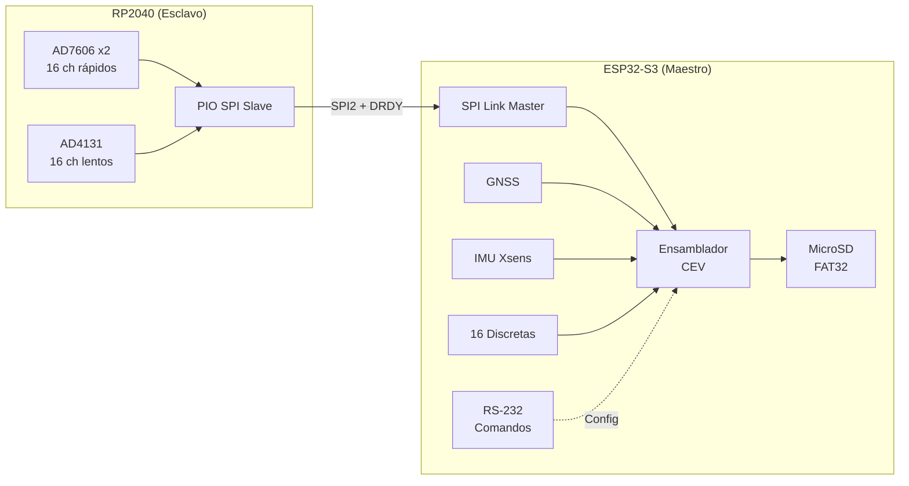
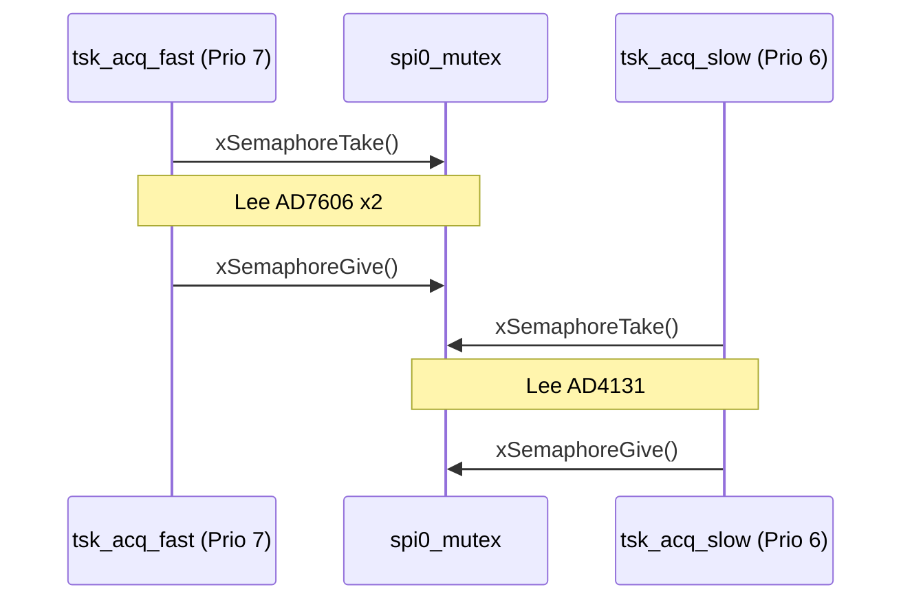
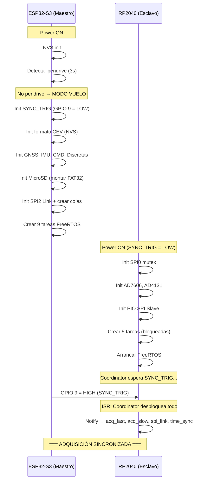

# Arquitectura Completa del Sistema FDR (Flight Data Recorder)

Este documento describe en detalle la arquitectura completa del Flight Data Recorder diseñado para la Cátedra de Ensayos en Vuelo (CEV) del Instituto Universitario Aeronáutico (IUA). El sistema utiliza una arquitectura dual de microcontroladores que divide las responsabilidades de adquisición y almacenamiento.

---

## Visión General



| Aspecto | Maestro (ESP32-S3) | Esclavo (RP2040) |
|---------|-------------------|-----------------|
| **Rol** | Orquestación, ensamblado CEV, almacenamiento | Adquisición analógica de alta velocidad |
| **RTOS** | FreeRTOS (integrado en ESP-IDF) | FreeRTOS (port para Pico SDK) |
| **Tareas** | 9 | 5 |
| **Bus inter-placa** | SPI2 Master | PIO SPI1 Slave |
| **Almacenamiento** | MicroSD (SDMMC / SPI3) | — |
| **Sensores locales** | GNSS, IMU, 16 discretas | 2× AD7606, 1× AD4131 |

---

## Parte 1: Esclavo (RP2040)

El RP2040 es el encargado exclusivo de la adquisición analógica en tiempo real. No almacena datos; solo los muestrea, empaqueta y transmite al Maestro.

### 1.1 Pines del Esclavo

#### Bus SPI0 — ADCs (compartido con mutex)
| Pin | Función |
|-----|---------|
| GP2 | SPI0 SCK |
| GP3 | SPI0 MOSI |
| GP4 | SPI0 MISO |
| GP5 | AD7606 Chip 1 — CS |
| GP6 | AD7606 Chip 2 — CS |
| GP7 | AD4131 — CS |
| GP9 | AD7606 CONVST (disparo de conversión) |
| GP10 | AD7606 BUSY (conversión en curso) |
| GP11 | AD7606 RESET |

#### Bus SPI1 — Enlace Inter-placa (PIO Slave)
| Pin | Función |
|-----|---------|
| GP12 | SCK (entrada desde el Maestro) |
| GP13 | MISO (salida hacia el Maestro) |
| GP15 | CS (entrada desde el Maestro) |
| GP8 | DRDY — Data Ready (salida hacia el Maestro) |

#### Sincronización
| Pin | Función |
|-----|---------|
| GP14 | SYNC_TRIG (entrada desde GPIO 9 del Maestro) |
| GP26 | PPS (entrada desde GPIO 37 del Maestro / módulo GPS) |

---

### 1.2 Módulos del Esclavo

#### `fast_signals.c` — Driver AD7606 (ADC Rápido)

Controla **2 chips AD7606** conectados al bus SPI0, proporcionando **16 canales analógicos simultáneos** (8 por chip).

- **Tipo de ADC:** SAR de 16 bits, muestreo simultáneo en todos los canales.
- **Velocidad:** 3000 muestras/segundo por canal.
- **Secuencia de lectura:**
  1. Pulso bajo en CONVST (GP9) → inicia conversión en ambos chips.
  2. Espera a que BUSY (GP10) baje (~4 µs).
  3. Toma el mutex de SPI0.
  4. Lee 8 words de 16 bits del Chip 1 (CS en GP5).
  5. Lee 8 words de 16 bits del Chip 2 (CS en GP6).
  6. Libera el mutex de SPI0.
- **Resultado:** 16 valores `int16_t` correspondientes a los canales ANA_1 a ANA_16.

#### `slow_signals.c` — Driver AD4131 (ADC Lento)

Controla **1 chip AD4131** en el mismo bus SPI0 (acceso protegido por mutex).

- **Tipo de ADC:** Sigma-Delta de 24 bits (se usan los 16 MSBs).
- **Velocidad:** ~150 Hz (escaneo secuencial de los 16 canales).
- **Secuencia de lectura:**
  1. Toma el mutex de SPI0.
  2. Lee secuencialmente los 16 canales (uno a uno).
  3. Libera el mutex de SPI0.
- **Resultado:** 16 valores `int16_t` correspondientes a los canales ANA_17 a ANA_32.

#### `spi_link_slave.c` + `spi_slave.pio` — Enlace SPI (PIO)

Implementa un **esclavo SPI por hardware PIO** en lugar del periférico SPI de hardware del RP2040.

- **¿Por qué PIO?** El periférico PL022 del RP2040 tiene un bug documentado que provoca desplazamientos de bits cuando opera en modo esclavo. El PIO emula un SPI bit-perfect con sincronismo de fase perfecto (CPOL=0, CPHA=0).
- **Funcionamiento:**
  1. Desencola un payload de `q_fast_data` o `q_slow_data`.
  2. Agrega header: Magic Byte (`0xFD`) + tipo + nº de secuencia + CRC16.
  3. Carga el paquete en el buffer TX del PIO.
  4. Activa la línea DRDY (GP8) para avisar al Maestro.
  5. El PIO transmite automáticamente cuando el Maestro genera los pulsos de clock.
  6. Desactiva DRDY tras la transmisión.

#### `time_sync.c` — Disciplina de Reloj PPS

Disciplina el reloj interno del RP2040 usando el pulso de 1 Hz (PPS) del GPS.

- Una ISR en GP26 captura el timestamp de `time_us_64()` en cada flanco de subida del PPS.
- Calcula el drift: `intervalo_real - 1.000.000 µs`.
- Aplica una corrección de offset a todos los timestamps futuros.
- **Resultado:** Error de sincronización < 4 µs sostenido.

---

### 1.3 Tareas del Esclavo (5 tareas FreeRTOS)

| Tarea | Nombre | Prio | Stack | Descripción |
|-------|--------|------|-------|-------------|
| `tsk_coordinator_slave` | `coordinator` | **8** | 768 B | Espera el flanco de SYNC_TRIG (GP14) desde el Maestro. Una vez recibido, desbloquea las 4 tareas de trabajo con `xTaskNotifyGive()` y se auto-suspende. Garantiza que toda la adquisición arranque en el mismo instante. |
| `tsk_acq_fast_slave` | `acq_fast` | **7** | 1 KB | Lee los 2× AD7606 a 3000 Hz. Empaqueta 30 muestras en un `fast_data_payload_t` y lo envía a la cola (~100 paquetes/s). |
| `tsk_acq_slow_slave` | `acq_slow` | **6** | 1 KB | Lee el AD4131 a ~150 Hz. Empaqueta los 16 canales en un `slow_data_payload_t` (~20 paquetes/s). |
| `tsk_spi_link_slave` | `spi_link` | **6** | 1 KB | Desencola paquetes, les agrega el header del protocolo y los transmite por PIO SPI al Maestro, señalizando con DRDY. |
| `tsk_time_sync_slave` | `time_sync` | **6** | 768 B | Recibe interrupciones del PPS y corrige el drift del oscilador para mantener timestamps sincronizados a < 4 µs. |

### 1.4 Compartición del Bus SPI0

El bus SPI0 es compartido entre los drivers del AD7606 y del AD4131 mediante un **mutex de FreeRTOS** (`spi0_mutex`). La tarea de adquisición rápida tiene prioridad 7 (mayor) sobre la lenta (prioridad 6), por lo que en caso de contención, las muestras rápidas siempre tienen precedencia.



---

## Parte 2: Maestro (ESP32-S3)

El ESP32-S3 es el cerebro del sistema: recibe datos de todas las fuentes, los ensambla en el formato CEV estándar y los persiste en la MicroSD.

### 2.1 Pines del Maestro

#### Bus SPI2 — Enlace Inter-placa (Master)
| Pin | Función |
|-----|---------|
| GPIO 11 | MOSI |
| GPIO 12 | CLK |
| GPIO 13 | MISO |
| GPIO 10 | CS |
| GPIO 45 | DRDY (entrada desde Esclavo) |

#### MicroSD (Modo SDMMC — PCB de producción)
| Pin | Función |
|-----|---------|
| GPIO 38 | CMD |
| GPIO 39 | CLK |
| GPIO 40 | D0 |

#### GNSS (UART2)
| Pin | Función |
|-----|---------|
| GPIO 17 | TX |
| GPIO 18 | RX |

#### IMU Xsens (UART0)
| Pin | Función |
|-----|---------|
| GPIO 43 | TX |
| GPIO 44 | RX |

#### Puerto de Comandos RS-232 (UART1)
| Pin | Función |
|-----|---------|
| GPIO 15 | TX |
| GPIO 16 | RX |

#### Señales de Control
| Pin | Función |
|-----|---------|
| GPIO 9 | SYNC_TRIG (salida hacia Esclavo) |
| GPIO 37 | PPS (salida hacia Esclavo) |
| GPIO 46 | Detección de Power-Loss (entrada, interrupción) |

#### Entradas Discretas (16 canales)
| Pins | Canales |
|------|---------|
| GPIO 1–8 | DIG_1 a DIG_8 |
| GPIO 35, 36, 46, 47, 48, 14, 21, 41 | DIG_9 a DIG_16 |

---

### 2.2 Componentes del Maestro (12 componentes)

#### `master_config` — Hub de Configuración
Contiene dos archivos fundamentales:
- **`pin_config.h`**: Asignación centralizada de TODOS los pines del sistema.
- **`protocol.h`**: Define el protocolo inter-placa: Magic Byte (`0xFD`), tipos de paquete (`0x01` = rápido, `0x02` = lento), estructuras de payload y funciones CRC16.

#### `spi_manager` — Configuración del Bus SPI
Configura el periférico **SPI2_HOST** como Master. Define los pines del bus (MOSI, MISO, CLK), agrega el dispositivo CS (GPIO 10) y habilita DMA para transferencias eficientes.

#### `spi_link` — Comunicación Inter-placa
Gestiona la recepción de datos desde el RP2040:
1. Espera interrupción en DRDY (GPIO 45).
2. Ejecuta transacción SPI2 full-duplex.
3. Valida el paquete: Magic Byte + CRC16.
4. Enruta según tipo:
   - `0x01` → cola `q_rx_fast` (datos rápidos)
   - `0x02` → cola `q_rx_slow` (datos lentos)
5. Lleva estadísticas de paquetes OK / errores.

#### `gnss` — Receptor GPS
- UART2 a 9600 baud (protocolo NMEA estándar).
- Parsea sentencias `$GPRMC` y `$GPGGA`.
- Extrae: fecha, hora UTC, latitud, longitud, calidad del fix.
- Reenvía la señal PPS del módulo GPS al GPIO 37 (hacia el Esclavo).
- Provee `gnss_get_datetime()` para el ensamblador CEV.

#### `imu_xsens` — Unidad de Medición Inercial
- UART0 a 115200 baud (protocolo binario Xsens MT).
- Parsea paquetes binarios y extrae:
  - Aceleración XYZ → DSP_1, DSP_2, DSP_3 (escalados ×500)
  - Giróscopo XYZ → DSP_4, DSP_5, DSP_6 (escalados ×100)
  - Magnetómetro XYZ → DSP_7, DSP_8, DSP_9 (escalados ×10000)
  - Roll, Pitch → DSP_10, DSP_11 (escalados ×100)
- Provee `imu_xsens_get_data()` para el ensamblador CEV.

#### `discrete_signals` — Entradas Digitales
- 16 GPIOs configurados como entrada con pull-down.
- Lee los 16 estados y los empaqueta en un bitmap `uint16_t`:
  - Bit 0 = DIG_1, Bit 15 = DIG_16.
- Provee `discrete_signals_read()` → `uint16_t`.

#### `cmd_port` — Puerto de Comandos RS-232
- UART1 a 115200 baud.
- Escucha tramas de 6 bytes: `[0xAA55] [CMD] [DATA]` (Little-Endian).
- Soporta 3 comandos:
  - **CMD1**: Lectura del valor actual de un canal específico.
  - **CMD2**: Escritura del formato de muestreo (1/2/3) en NVS (persistente).
  - **CMD3**: Lectura del formato de muestreo actual desde NVS.
- Puede enviar datos en tiempo real a 2 Hz cuando se solicita.

#### `sample_format` — Ensamblador de Formatos CEV
Implementa el estándar de sub-conmutación del Centro de Ensayos en Vuelo. Combina datos de todos los subsistemas en frames de `int16_t`:

| Formato | Frames/ciclo | Words/frame | Ciclos/seg | Frames/seg | Datos/seg |
|---------|-------------|-------------|-----------|-----------|-----------|
| F1 | 40 | 17 | 75 | 3000 | ~102 KB/s |
| F2 | 40 | 11 | 75 | 3000 | ~66 KB/s |
| F3 | 10 | 6 | 10 | 100 | ~1.2 KB/s |

**Estructura de un frame (Formato 1):**
- Words 0–15: Canales analógicos rápidos ANA_1 a ANA_16 (presentes en CADA frame).
- Word 16: Parámetro sub-conmutado (rota según una tabla de 40 posiciones).

**Tabla de sub-conmutación (Word 16, F1):**

| Frame 0–9 | Frame 10–19 | Frame 20–29 | Frame 30–39 |
|-----------|-------------|-------------|-------------|
| DIG, ANA_17–ANA_25 | DIG, ANA_26–ANA_32, DSP_1, DSP_2 | DIG, DSP_3–DSP_9, DSP_10, DSP_11 | DIG, DSP_12, DIA, MES, AÑO, HOR, MIN, SEG, LIBRE, LIBRE |

La función `sample_format_assemble_frame(frame_id, buffer)` consulta los registros globales de cada subsistema y construye el frame completo.

#### `sd_storage` — Almacenamiento en MicroSD
- **Producción:** Periférico SDMMC nativo, modo 1-bit a 40 MHz.
- **Testbench:** SPI3 a 400 kHz (módulo externo con AMS1117).
- Filesystem FAT32 montado vía VFS de ESP-IDF.
- Archivos secuenciales: `FDR_0001.bin`, `FDR_0002.bin`, etc.
- **Header de 12 bytes** al inicio de cada archivo:

| Offset | Campo | Tipo | Valor |
|--------|-------|------|-------|
| 0–3 | magic | uint32 | `0xFD464452` |
| 4 | version | uint8 | `1` |
| 5 | format | uint8 | `1`, `2` o `3` |
| 6–7 | reserved | uint16 | `0x0000` |
| 8–11 | crc32 | uint32 | CRC32 de bytes [0..7] |

- Buffer de escritura de **4 KB** con `fsync` cada 8 volcados.
- Protección ante corte de energía: `flush + fsync + fclose` disparado por interrupción en GPIO 46.

#### `supervisor` — Watchdog de Software
- Cada tarea se registra con un nombre y un timeout (ej: 5000 ms).
- Las tareas hacen `supervisor_checkin()` periódicamente.
- El supervisor verifica cada segundo que todas las tareas hayan reportado.
- Si alguna falla → log de error.

#### `usb_transfer` — Descarga a Pendrive
- Driver USB Host MSC (Mass Storage Class).
- Solo activo en **Modo Descarga** (pendrive conectado al encender).
- `usb_transfer_copy_all()` copia todos los `FDR_*.bin` de la SD al pendrive.

---

### 2.3 Tareas del Maestro (9 tareas FreeRTOS)

| Tarea | Nombre | Prio | Stack | Descripción |
|-------|--------|------|-------|-------------|
| `tsk_frame_writer_master` | `writer` | **8** | 8 KB | Ensambla frames CEV a tasa fija y los escribe a la MicroSD. Maneja señal de power-loss. |
| `tsk_time_sync_master` | `time_sync` | **7** | 4 KB | Recibe datos del GNSS y gestiona la señal PPS. Alimenta fecha/hora UTC al ensamblador. |
| `tsk_spi_link_master` | `spi_link` | **6** | 4 KB | Recibe paquetes del RP2040 por SPI2, valida Magic+CRC y enruta a las colas. |
| `tsk_data_proc_master` | `data_proc` | **5** | 4 KB | Desencola datos rápidos (ANA_1–16) y los deposita en registros globales. |
| `tsk_slow_proc_master` | `slow_proc` | **5** | 4 KB | Desencola datos lentos (ANA_17–32) y actualiza registros globales. |
| `tsk_discrete_master` | `discrete` | **5** | 2 KB | Lee 16 entradas digitales y las empaqueta en bitmap de 16 bits. |
| `tsk_imu_master` | `imu` | **5** | 4 KB | Recibe datos de la IMU Xsens por UART y los escala a int16. |
| `tsk_cmd_port_master` | `cmd_port` | **4** | 4 KB | Atiende consultas del protocolo RS-232 (lectura de canal, config de formato). |
| `tsk_supervisor_master` | `supervisor` | **3** | 2 KB | Watchdog: verifica que todas las tareas hagan check-in dentro de su timeout. |

---

## Parte 3: Flujo de Datos Completo

### 3.1 Secuencia de Arranque



### 3.2 Flujo de Datos en Régimen

```
┌─────────────────── RP2040 (ESCLAVO) ───────────────────┐
│                                                         │
│  AD7606 x2 ──3kHz──► tsk_acq_fast ──► q_fast_data ─┐  │
│     (SPI0)              (prio 7)        (100 pkt/s)  │  │
│                                                      │  │
│  AD4131 ────150Hz──► tsk_acq_slow ──► q_slow_data ─┤  │
│   (SPI0)               (prio 6)        (20 pkt/s)   │  │
│                                                      │  │
│          tsk_spi_link_slave ◄────────────────────────┘  │
│               (prio 6)                                  │
│                │                                        │
│                │ Agrega Header + CRC16                  │
│                │ Carga en buffer PIO                    │
│                ▼                                        │
│           DRDY = HIGH                                   │
└───────────────│─────────────────────────────────────────┘
                │ SPI1 (PIO) + DRDY (GP8)
                ▼
┌─────────────────── ESP32-S3 (MAESTRO) ─────────────────┐
│                                                         │
│  tsk_spi_link_master ──► Valida Magic + CRC16          │
│       (prio 6)           │                              │
│                    ┌─────┴──────┐                       │
│                    ▼            ▼                       │
│              q_rx_fast    q_rx_slow                     │
│                    │            │                       │
│              data_proc    slow_proc                     │
│               (prio 5)    (prio 5)                     │
│                    │            │                       │
│                    ▼            ▼                       │
│              ┌──────────────────────┐                   │
│              │   REGISTROS GLOBALES │◄── discrete (p5)  │
│              │   (datos más         │◄── imu_xsens (p5) │
│              │    recientes de      │◄── gnss (p7)      │
│              │    cada subsistema)  │                    │
│              └──────────┬───────────┘                   │
│                         │                               │
│              sample_format_assemble_frame()             │
│                         │                               │
│              tsk_frame_writer_master (prio 8)           │
│                         │                               │
│              sd_storage_write() ──► buffer 4KB          │
│                         │              │                │
│                         ▼         fsync cada 8          │
│                  MicroSD (FAT32)                        │
│                  FDR_XXXX.bin                           │
│                  [Header 12B][Frame][Frame][Frame]...   │
└─────────────────────────────────────────────────────────┘
```

### 3.3 Estructura del Archivo de Vuelo

```
┌─────────────────────────────────────────────────┐
│ HEADER (12 bytes)                               │
│ [Magic: 0xFD464452] [Ver:1] [Fmt] [Rsv] [CRC]  │
├─────────────────────────────────────────────────┤
│ Frame 0:  [W0][W1]...[W16]   (34 bytes en F1)  │
│ Frame 1:  [W0][W1]...[W16]                      │
│ Frame 2:  [W0][W1]...[W16]                      │
│ ...                                              │
│ Frame 39: [W0][W1]...[W16]   ← fin del ciclo 1 │
├ ─ ─ ─ ─ ─ ─ ─ ─ ─ ─ ─ ─ ─ ─ ─ ─ ─ ─ ─ ─ ─ ─┤
│ Frame 0:  [W0][W1]...[W16]   ← inicio ciclo 2  │
│ ...                                              │
│ Frame 39: [W0][W1]...[W16]   ← fin del ciclo 2 │
├ ─ ─ ─ ─ ─ ─ ─ ─ ─ ─ ─ ─ ─ ─ ─ ─ ─ ─ ─ ─ ─ ─┤
│ ...                 (75 ciclos por segundo)       │
└─────────────────────────────────────────────────┘
```

---

## Parte 4: Protocolo SPI Inter-placa

### Estructura de un paquete

```
┌───────┬──────┬──────────┬─────────┬─────────────────────┬───────┐
│ Magic │ Type │ Sequence │ Frame   │       Payload       │ CRC16 │
│ 0xFD  │ 1B   │  2B      │ Index   │    (variable)       │  2B   │
│  1B   │      │          │  2B     │                     │       │
└───────┴──────┴──────────┴─────────┴─────────────────────┴───────┘
```

| Campo | Tamaño | Descripción |
|-------|--------|-------------|
| Magic | 1 byte | Siempre `0xFD` — permite detectar desalineación |
| Type | 1 byte | `0x01` = datos rápidos, `0x02` = datos lentos |
| Sequence | 2 bytes | Contador rolling para detectar pérdida de paquetes |
| Frame Index | 2 bytes | Índice del sub-frame dentro del ciclo |
| Payload | variable | `fast_data_payload_t` o `slow_data_payload_t` |
| CRC16 | 2 bytes | Checksum para detección de errores de transmisión |

### Payloads

```c
typedef struct {
    int16_t channels[16];   // 16 canales ADC
    int64_t timestamp_us;   // Timestamp disciplinado por PPS
} fast_data_payload_t;      // ~100 paquetes/seg

typedef struct {
    int16_t channels[16];   // 16 canales ADC lentos
    int64_t timestamp_us;   // Timestamp disciplinado
} slow_data_payload_t;      // ~20 paquetes/seg
```

---

## Parte 5: Modos de Operación

### Modo Vuelo (sin pendrive al encender)
Es el modo normal de operación. El sistema completo adquiere, procesa y almacena datos continuamente hasta que se corte la energía o se detecte un power-loss (GPIO 46), en cuyo caso se cierra el archivo de forma segura.

### Modo Descarga (pendrive conectado al encender)
El sistema no arranca la adquisición. En su lugar:
1. Monta la MicroSD.
2. Monta el pendrive via USB Host MSC.
3. Copia todos los archivos `FDR_*.bin` al pendrive.
4. Queda en idle (el técnico puede retirar el pendrive y apagar).

---

## Parte 6: Post-proceso (FDR Converter)

Una vez descargados los archivos `.bin`, la herramienta **FDR Converter** (Python/Tkinter) permite:
1. **Autodetección** del formato CEV via el header de 12 bytes.
2. **Decodificación** de la sub-conmutación (des-multiplexación de los parámetros).
3. **Exportación a CSV** con una columna por parámetro y una fila por ciclo.
4. **Visualización** con gráficos interactivos (zoom/pan) de señales analógicas, discretas, IMU y timestamps GNSS.
5. **Detección automática de pendrive** para uso offline en el hangar.
